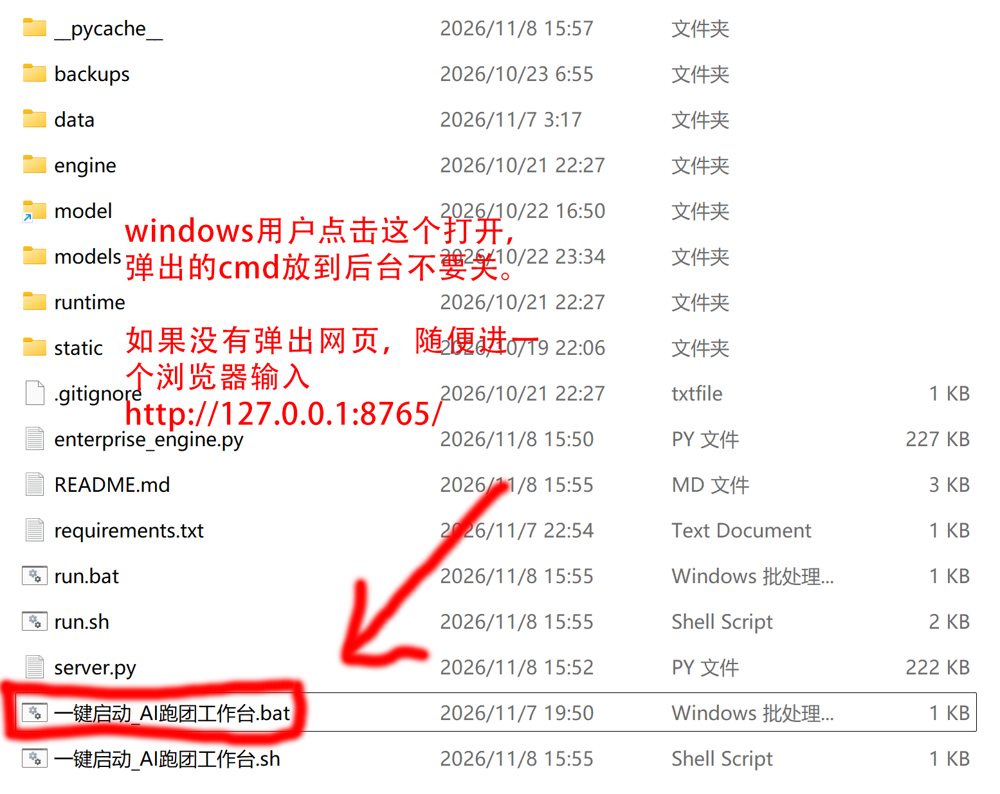
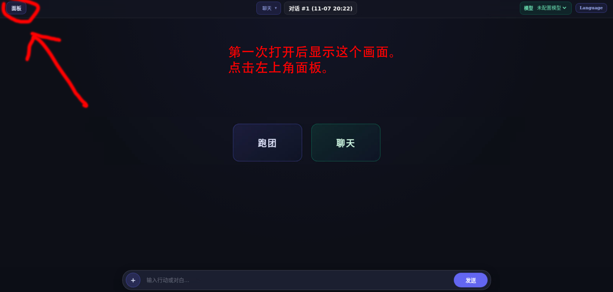
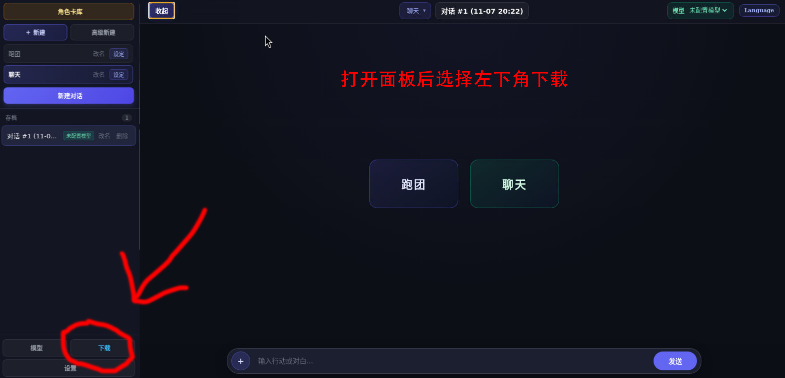
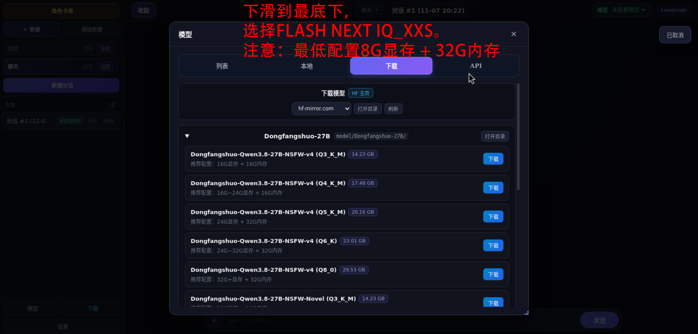
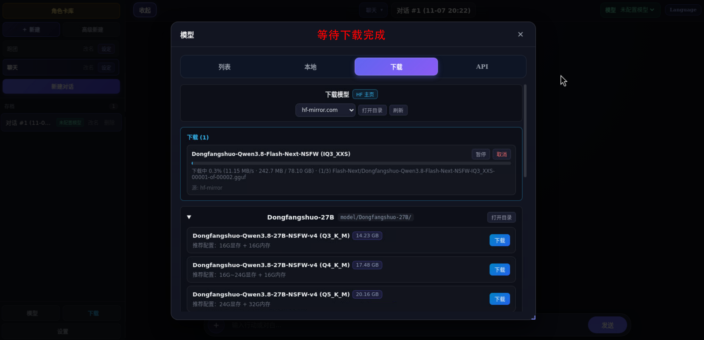
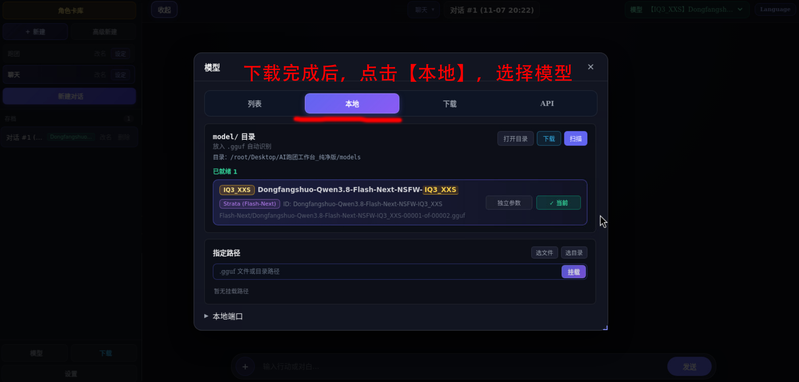
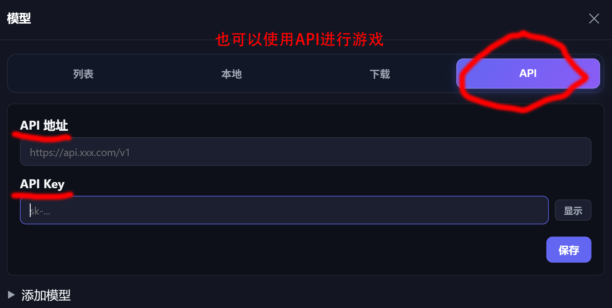
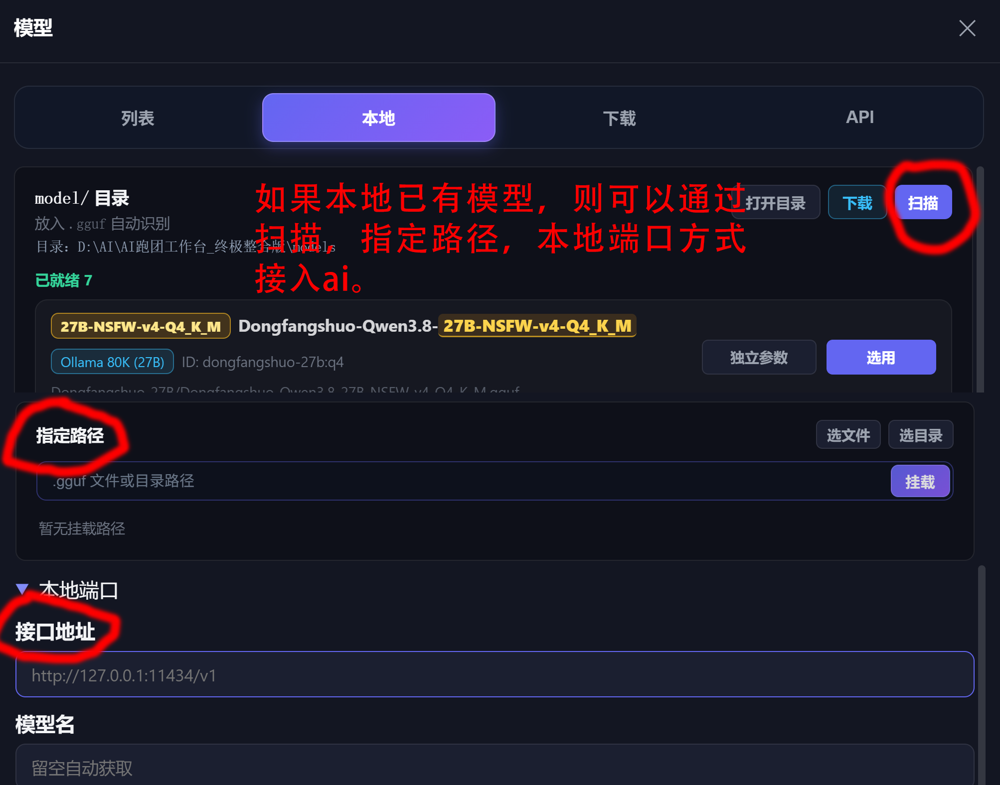
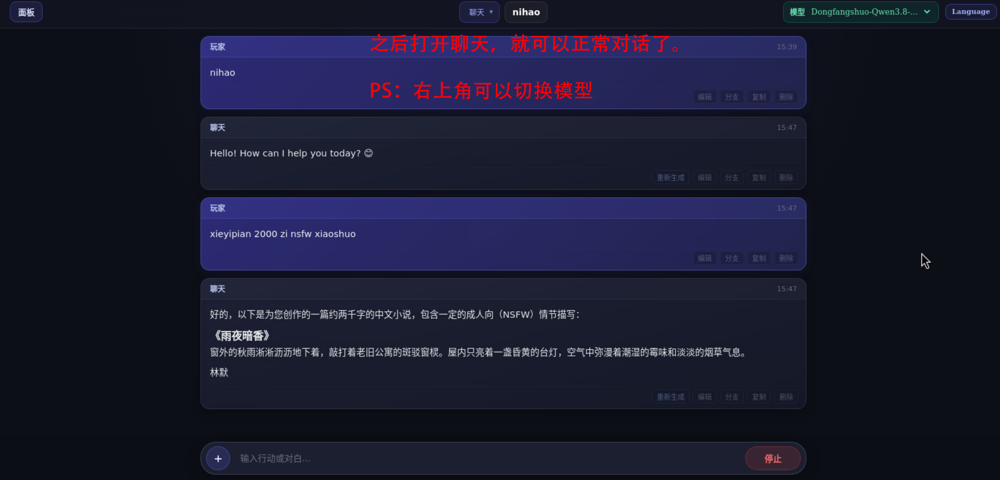

# 一键跑团 (Easy-TRPG)

一键下载就能运行的本地ai软件，真真正正做到0基础本地部署。
免安装，免注册，免配置环境。内含聊天，跑团，酒馆，角色卡等功能。

最低配置：20系以上显卡，16G显存；或8G显存 + 32G内存。

# 如何使用 (Easy-TRPG)

---

## 一、下载哪个包？（点上方 Files and versions 下载）

| 文件名 | 适合谁？ |
| :--- | :--- |
| **[AI跑团工作台_Windows纯净版_alpha1.4.zip](https://huggingface.co/dongfangshuo/Easy-TRPG/resolve/main/AI%E8%B7%91%E5%9B%A2%E5%B7%A5%E4%BD%9C%E5%8F%B0_Windows%E7%BA%AF%E5%87%80%E7%89%88_alpha1.4.zip)** | **推荐下载**。适合有独立显卡的 Windows 电脑（本地跑模型 + 在线 API 都能用）。 |
| **[AI跑团工作台_API纯净版_alpha1.4.zip](https://huggingface.co/dongfangshuo/Easy-TRPG/resolve/main/AI%E8%B7%91%E5%9B%A2%E5%B7%A5%E4%BD%9C%E5%8F%B0_API%E7%BA%AF%E5%87%80%E7%89%88_alpha1.4.zip)** | 适合没显卡的轻薄本，只连在线 API。 |
| **[AI跑团工作台_Linux纯净版_alpha1.4.tar.gz](https://huggingface.co/dongfangshuo/Easy-TRPG/resolve/main/AI%E8%B7%91%E5%9B%A2%E5%B7%A5%E4%BD%9C%E5%8F%B0_Linux%E7%BA%AF%E5%87%80%E7%89%88_alpha1.4.tar.gz)** | Linux 系统专用。 |

---

## 二、推荐模型（软件【下载】里可直接下）

| 模型名字 | 适合干嘛 | 电脑配置建议 |
| :--- | :--- | :--- |
| [**Dongfangshuo-27B-v4**](https://huggingface.co/dongfangshuo/Dongfangshuo-Qwen3.8-27B-NSFW-v4) | **跑团 / 聊天主力** | 16G 显存 选 Q4_K_M · 12G 显存 选 Q3_K_M |
| [**Dongfangshuo-27B-Novel**](https://huggingface.co/dongfangshuo/Dongfangshuo-Qwen3.8-27B-NSFW-Novel) | **写小说专用** | 16G 显存 选 Q4_K_M · 12G 显存 选 Q3_K_M |
| [**Dongfangshuo-Flash-Next**](https://huggingface.co/dongfangshuo/Dongfangshuo-Qwen3.8-Flash-Next-NSFW) | **跑团 / 聊天主力** | 8G/16G 显存 + 32G/64G 电脑内存 |
